# RoboDesk — reviewer guide

A short path through everything the brief asks for: **start it, watch the demos, try it, check the rules.** It takes about 10 minutes. Design reasoning is in [NOTES.md](../NOTES.md).

## 1. Start it

```bash
git clone https://github.com/Paulin-NIYOBYOSE/robodesk.git && cd robodesk
docker compose up --build          # first build ~2–3 min
```

| | |
|---|---|
| App (landing page → **Sign in**) | <http://localhost:3000> |
| API docs (Swagger) | <http://localhost:8000/docs> |
| Health | <http://localhost:8000/health> |
| Tests (219, real PostgreSQL) | `docker compose run --build --rm tests` |

Startup migrates the database, seeds the users below and imports the supplied `seed/episodes.csv` (171 imported, 2 duplicates skipped, 16 rejected).

**Test accounts** (development only, from `seed/users.json`):

| Role | Email | Password |
|---|---|---|
| Admin | admin@example.com | admin123 |
| Operator | ops1@example.com / ops2@example.com | ops123 |
| Client | client-a@example.com (Acme Robotics) / client-b@example.com (Beta Labs) | client123 |

## 2. Watch the demos (2 minutes in total)

Recorded on the Docker stack from a fresh database. The `.webm` files play in Chrome, Firefox and Edge; on GitHub, open a file and click **View raw**.

| Video | Shows |
|---|---|
| [01 · Client creates a request](demo/01-client-creates-request.webm) (15 s) | Landing page, client sign-in, new request, status history |
| [02 · Operator assigns and delivers](demo/02-operator-assigns-and-delivers.webm) (25 s) | Delivery blocked until enough episodes; bad episodes can't be selected; live export status; delivery |
| [03 · Reject, rework, accept](demo/03-client-rejects-then-accepts.webm) (21 s) | Rejection needs a reason, operator reworks, client accepts, full audit trail |
| [04 · Import, analytics, admin, access control](demo/04-import-analytics-admin-and-access.webm) (33 s) | Idempotent re-import report, analytics, user management, another client's request → 404, staff page → denied |

## 3. Try it yourself

Each step names the requirement it demonstrates and what you should see.

1. **Client creates a request.** Sign in as `client-a`, click **New request**, submit `pick cup`, 4 episodes, any future date.
   → The request page shows *Submitted*, `0 / 4` assigned, and a history entry saying who submitted it and when.
2. **Operator workflow and assignment rules.** Sign out, sign in as `ops1`, open the request, click **Start work**.
   - **Mark as delivered** is disabled: delivery needs at least 4 assigned episodes.
   - In *Add episodes*, set Quality to **Bad**: those rows can't be selected and say *Bad quality*. Episodes already in another request say *Assigned to #…*.
   - Tick 4 available episodes and click **Assign**. The progress bar shows `4 / 4`, and each episode's export moves *Queued → Exporting → Exported* (about 20% fail and retry automatically).
   - Click **Mark as delivered**, then confirm.
3. **Client review.** As `client-a`, open the request, click **Reject delivery**: the reason is required. Then, as an operator, **Start rework → Mark as delivered**; as `client-a`, **Accept delivery**.
   → *Status history* lists every change with actor, time and the rejection reason.
4. **Client isolation (IDOR).** Sign in as `client-b` and open `http://localhost:3000/requests/1`.
   → *Request not found*: the API answers 404 for another client's request. Visiting `/episodes` shows *You don't have access* (the API would answer 403).
5. **Import idempotency.** As an operator, go to **Episodes → Import CSV** and upload `seed/episodes.csv`.
   → **0 imported, 173 skipped duplicates, 16 rejected**, each rejection with a line number and reason (e.g. `'45.5' is not a whole number of seconds`, `'arm-99' is not a known robot`).
6. **Analytics.** Open **Analytics**: episodes per day per robot, requests by status, median submitted → delivered time, top 5 tasks by good episodes. The chart also has a table view.
7. **Admin.** Sign in as `admin`, open **Users**: create a user, change a role, deactivate an account (each confirmed).
   → The deactivated user can't sign in, and their existing token stops working immediately.
8. **Operability.** Run `docker compose logs backend`: one JSON line per request with `method`, `path`, `status`, `duration_ms` and `user_id`.

## 4. Check the rules from the command line

The UI hiding a button is not the protection; these calls show the API enforcing it (with request 1 belonging to `client-a`):

```bash
login() { curl -s localhost:8000/api/auth/login -H 'Content-Type: application/json' \
  -d "{\"email\":\"$1\",\"password\":\"$2\"}" | python3 -c 'import sys,json; print(json.load(sys.stdin)["access_token"])'; }
CLIENT_B=$(login client-b@example.com client123)
OPS=$(login ops1@example.com ops123)

curl -s -o /dev/null -w '%{http_code}\n' localhost:8000/api/requests                                  # 401 no token
curl -s -o /dev/null -w '%{http_code}\n' localhost:8000/api/requests/1 -H "Authorization: Bearer $CLIENT_B"   # 404 other client's request
curl -s -o /dev/null -w '%{http_code}\n' localhost:8000/api/episodes   -H "Authorization: Bearer $CLIENT_B"   # 403 operators only
curl -s -o /dev/null -w '%{http_code}\n' localhost:8000/api/users      -H "Authorization: Bearer $OPS"        # 403 admins only
curl -s "localhost:8000/api/analytics?from=2026-08-01&to=2026-09-30" -H "Authorization: Bearer $OPS" | python3 -m json.tool | head -20
```

## 5. Requirement checklist

| Brief requirement | Where it lives | Proved by |
|---|---|---|
| Roles; auth on every action except login; server-side authorization | `app/api/deps.py`, `_visible_to` in `app/services/requests.py` | `test_authorization.py` (includes a sweep: every endpoint → 401 without a token), `test_auth.py` |
| Status workflow, owning roles only, every change recorded | `app/services/workflow.py`, `request_status_history` table | `test_workflow.py` (every status pair × role), `test_requests.py` |
| Assignment rules (one request per episode, good/usable only, delivery gate) | `app/services/assignments.py`, unique constraint on `assignments.episode_id` | `test_assignments.py` (includes a real two-transaction race) |
| Idempotent CSV import with a report | `app/services/importer.py`, `POST /api/episodes/import`, `python -m app.cli import-episodes` | `test_import.py` (the supplied file, each messy case, re-import) |
| Analytics computed in the database | `app/services/analytics.py` | `test_analytics.py`; 5M-row timings in [README](../README.md#scale) |
| PostgreSQL + migrations | `backend/migrations/` (Alembic) | tests rebuild the schema from migrations; CI runs `alembic check` |
| `/health` and structured request logs | `app/api/routes/health.py`, `app/api/middleware.py` | `test_operability.py` |
| One-command startup | `docker-compose.yml` (postgres → migrate/seed → API, worker, frontend) | CI job *Docker Compose smoke test* |
| Tests runnable with one command; CI | `docker compose run --build --rm tests`; `.github/workflows/ci.yml` | 219 passing |
| Frontend for clients and operators | `frontend/src/pages` | videos and screenshots above |
| Stretch: background export | `app/services/exports.py`, `app/worker.py` | `test_exports.py`, video 02 |
| `NOTES.md` (design, trade-offs, what went wrong, security, scale, AI tooling) | [NOTES.md](../NOTES.md) | — |

## 6. Screenshots

| | |
|---|---|
| 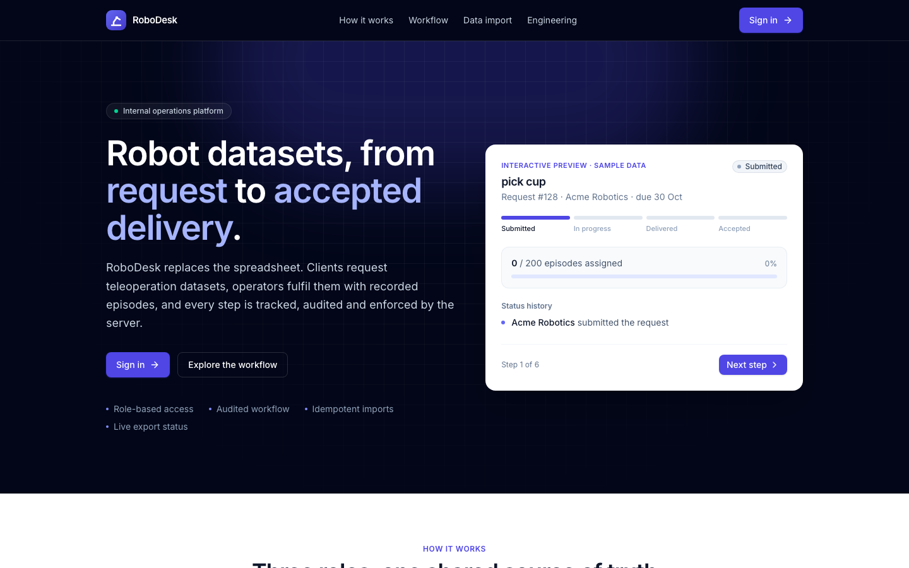 Landing page | 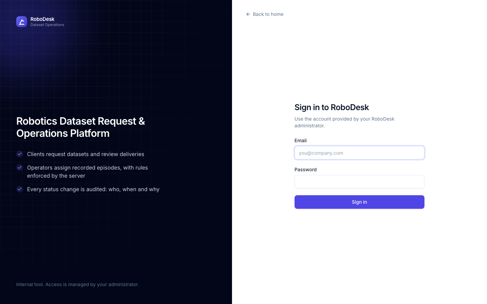 Sign in |
| 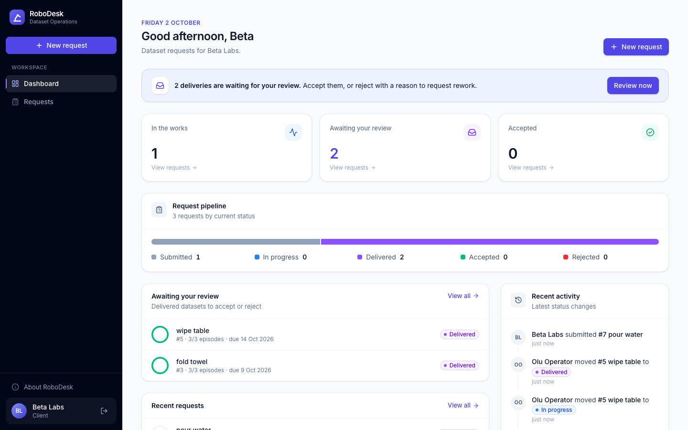 Client dashboard | 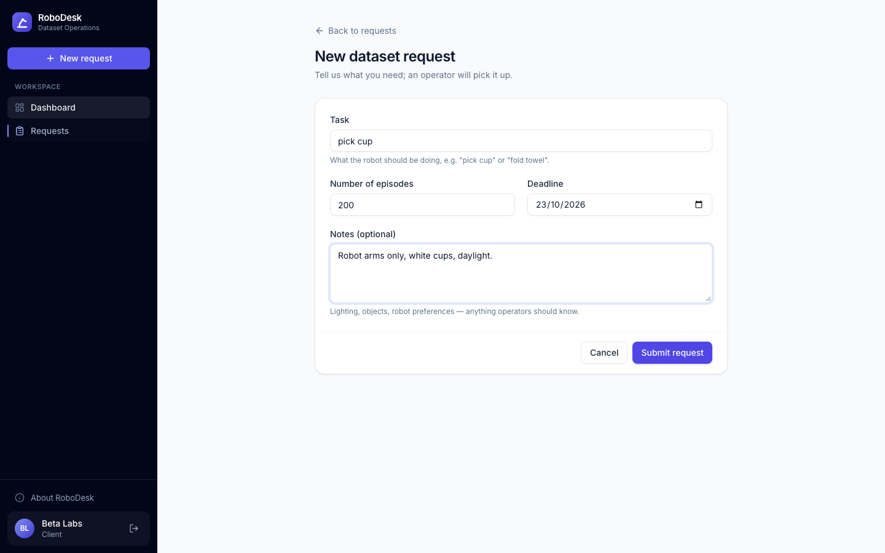 New request |
| 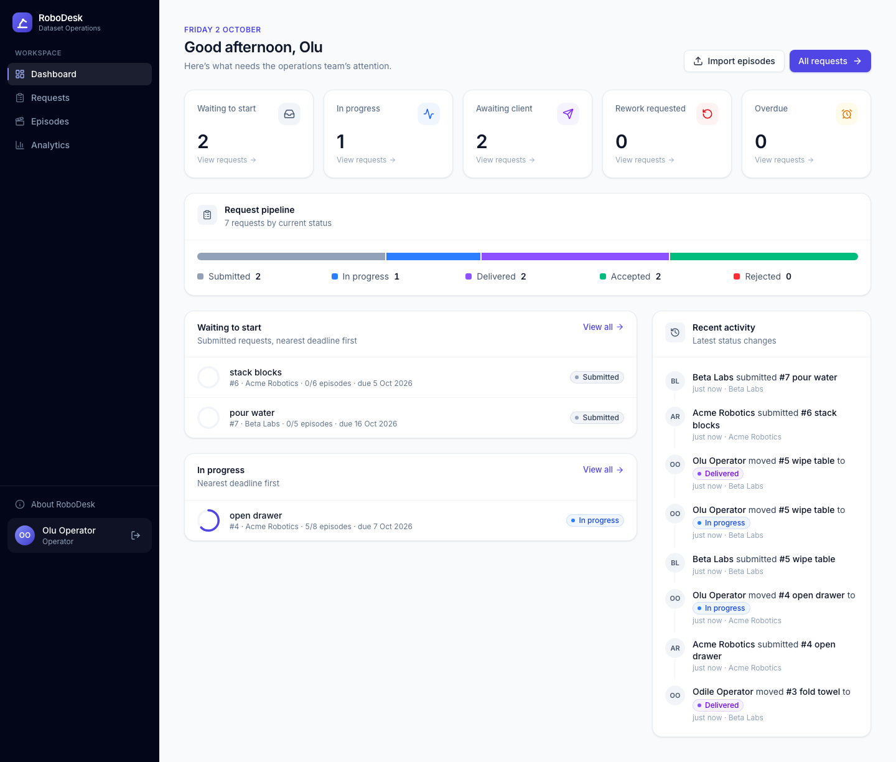 Operator dashboard | 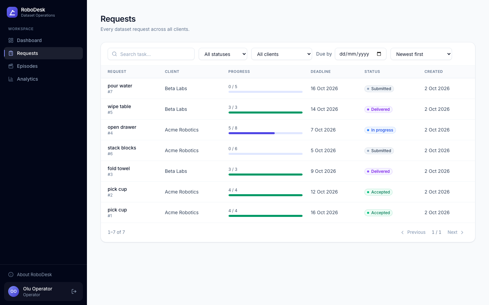 Requests list with filters |
| 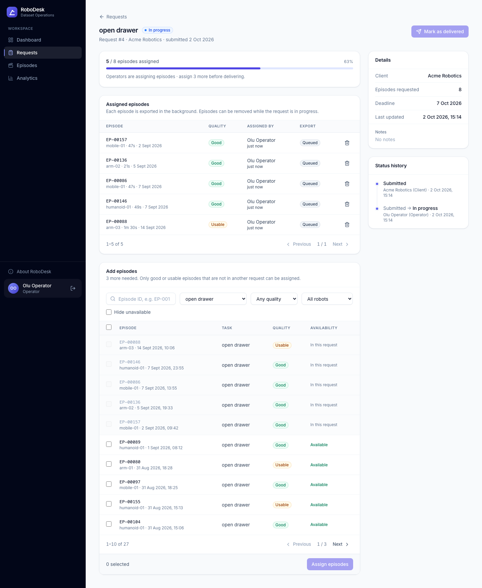 Assigning episodes | 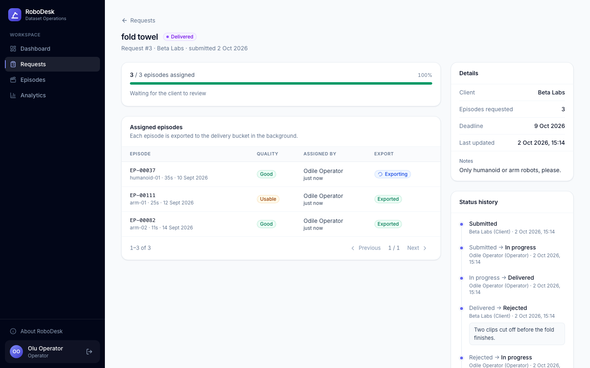 Rejection reason and audit trail |
| 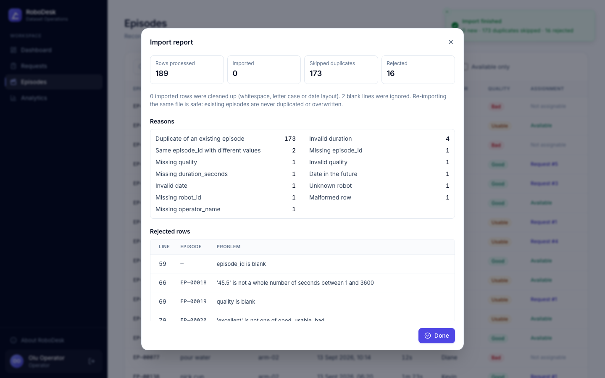 Import report | 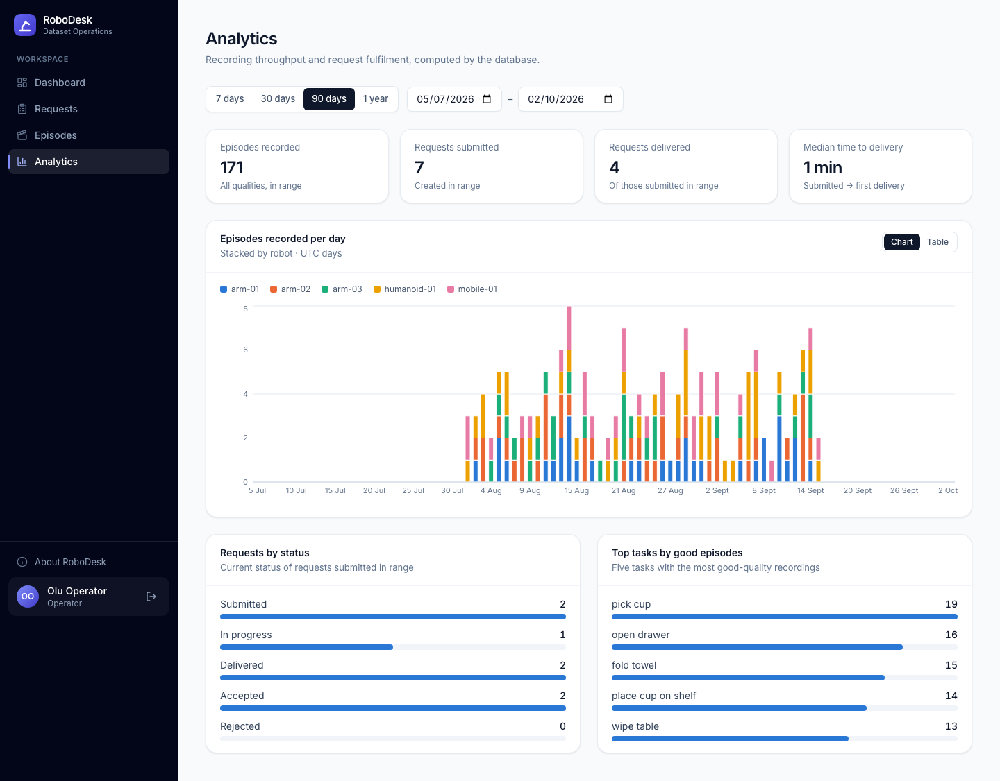 Analytics |
| 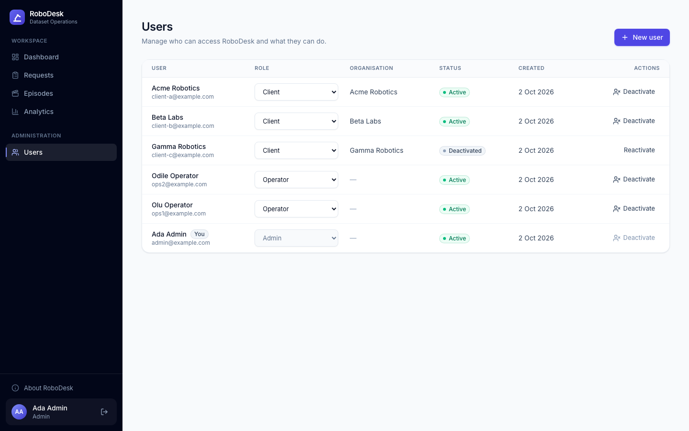 User management | 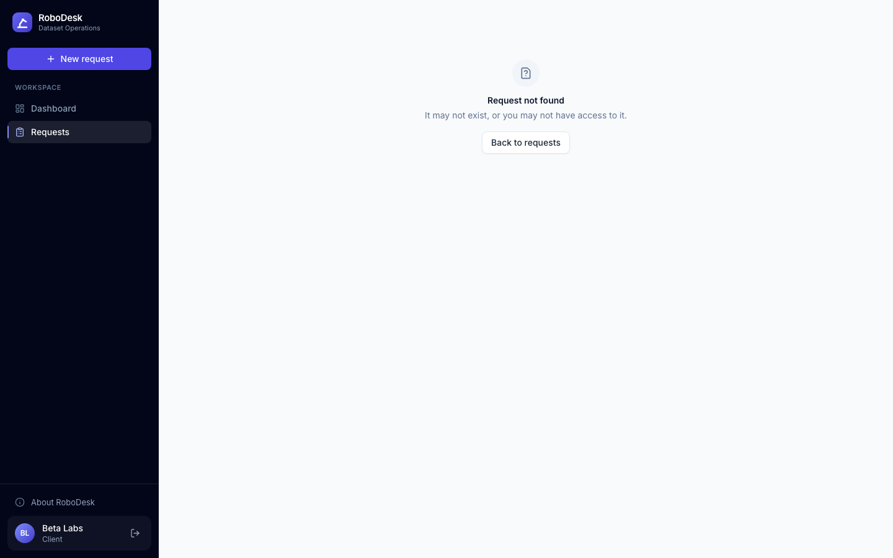 Another client's request: 404 |
